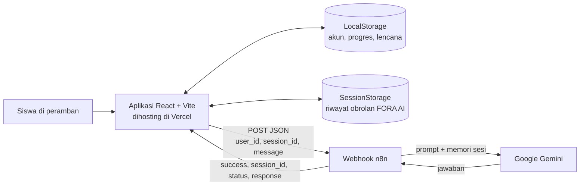
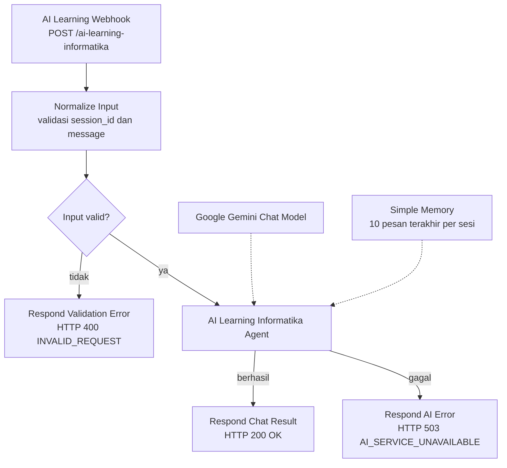

# GAMIFORA: Petualangan Belajar Informatika

Web gamifikasi belajar informatika untuk siswa SMP, dilengkapi asisten AI bernama **FORA AI** yang berjalan lewat webhook n8n dan Google Gemini.

| | |
| :--- | :--- |
| **Kompetisi** | LOGICODIX 2026 Hackathon |
| **Kategori** | Web |
| **Subtema** | Smart & Fun Education |
| **Nama aplikasi** | GAMIFORA |
| **Asisten AI** | FORA AI |
| **Nama tim** | TEAM SIKATZZ |
| **Repositori GitHub** | https://github.com/HealthyHustle/GAMIFORA/upload |
| **Video demo** | https://youtu.be/9cnhT2xUqvk?si=_19-4o_oWwMbBUgr |

## Anggota Tim

| Nama | Peran | GitHub |
| Faisal Rizky Ramadandi | Ketua tim, Produk Prototype | @HealthyHustle |
| Fauzan Fahmi Nur Ilmi Sidiq | Pengembang Produk | - |
| Aulia Kendra Kuswanda | Designer | - |
| Azkia Jasmine | Designer | - |

Asal sekolah/institusi: Universitas Pendidikan Indonesia

---

## Masalah yang Diangkat

Informatika di SMP memuat konsep yang abstrak, misalnya algoritma, percabangan, flowchart, jaringan, dan keamanan digital. Siswa sering menerima materi sebagai teks dan latihan soal yang monoton, sehingga sulit melihat kaitannya dengan kehidupan sehari-hari. Akibatnya motivasi belajar menurun dan konsep logika tidak benar-benar dipahami. Siswa yang bingung di luar jam pelajaran juga tidak selalu punya tempat bertanya.

## Solusi

GAMIFORA mengemas pelajaran informatika menjadi petualangan di hutan bergaya game. Siswa membaca enam materi singkat, mengerjakan kuis, lalu menyusun puzzle flowchart secara langsung. Poin, bintang, peringkat, dan lencana memberi umpan balik yang cepat dan terasa seperti bermain. Bila butuh penjelasan tambahan, siswa dapat bertanya kepada **FORA AI**, asisten yang hanya menjawab seputar informatika dan teknologi digital.

## Target Pengguna

- **Utama:** siswa SMP yang belajar informatika.
- **Pendukung:** guru informatika yang ingin media latihan interaktif, serta siapa pun yang baru mulai belajar logika komputasi.

---

## Fitur Utama

Semua fitur di bawah sudah diimplementasikan dan dapat dijalankan.

**Akun dan progres**
- Masuk atau daftar otomatis dengan nama, email, dan password (akun baru dibuat saat pertama kali masuk). Validasi form disertai pesan kesalahan per kolom.
- Progres, poin, riwayat hasil, dan lencana disimpan per akun di peramban pengguna.

**Mainboard (dashboard)**
- Kartu profil dengan avatar, peringkat petualang (dari Penjelajah Pemula hingga Master Flowchart), level aktif, dan bar XP (maksimum 470 XP).
- Panel "Level Selanjutnya" yang menunjukkan sisa poin untuk membuka level berikutnya.
- Kartu menuju FORA AI, riwayat pencapaian, dan riwayat hasil terakhir.

**Materi pembelajaran (6 modul)**
- Dasar-Dasar Informatika; Perangkat Keras dan Perangkat Lunak; Jaringan Komputer dan Internet; Keamanan Digital; Algoritma dan Logika; Flowchart.
- Tiap modul memuat bagian materi, diagram alur singkat, contoh sehari-hari, rangkuman, dan penanda "sudah dibaca".

**Empat level tantangan** (dibuka berurutan; level berikutnya terkunci sampai syarat poin terpenuhi)

| Level | Judul | Jenis | Target lulus | Skor maksimum |
| :--- | :--- | :--- | :--- | :--- |
| 1 | Penjelajah Informatika | Kuis pilihan ganda (10 soal) | 80 | 100 |
| 2 | Ahli Digital | Kuis pilihan ganda (10 soal) | 100 | 100 |
| 3 | Perancang Logika | Puzzle flowchart: bilangan genap atau ganjil | 120 | 120 |
| 4 | Master Flowchart | Puzzle flowchart: rata-rata nilai dan kelulusan | 150 | 150 |

- **Kuis:** setiap soal bernilai 10 poin, urutan soal dan pilihan jawaban diacak tiap percobaan, dan setiap soal disertai penjelasan jawaban.
- **Puzzle flowchart:** potongan simbol (terminator, input/output, proses, keputusan) diseret ke slot bernomor, atau diketuk lalu diketuk pada slot tujuan. Penilaian berdasarkan graf alur: penempatan simbol, ketepatan panah beserta label YA/TIDAK, dan bonus penyelesaian. Tersedia 3 petunjuk bertahap dan umpan balik kesalahan yang spesifik.
- Poin yang dihitung adalah skor terbaik tiap level, sehingga mengulang level tidak menggandakan poin.

**Gamifikasi:** bintang 0-3 per level dan 9 lencana (misalnya Langkah Pertama, Kutu Buku Hutan, Skor Sempurna, Mandiri, Penakluk GAMIFORA). Halaman perayaan menampilkan skor, poin yang diperoleh, level yang terbuka, dan lencana baru.

**FORA AI**
- Asisten tanya-jawab informatika yang terhubung ke webhook n8n dan model Google Gemini.
- Jawaban dirender dalam Markdown (judul, daftar, tabel, kutipan) dengan pewarnaan sintaks kode (Python, JavaScript, TypeScript, CSS, JSON, Bash, SQL, C, C++, Java).
- Tombol salin untuk jawaban dan blok kode, sesi obrolan baru, saran topik cepat, kirim ulang bila gagal, dan penanganan kesalahan jaringan.
- AI mengingat konteks percakapan dalam satu sesi, sehingga pertanyaan lanjutan dapat dijawab sesuai konteks.
- Bila alamat webhook belum diatur, aplikasi menampilkan pesan "Layanan AI belum dikonfigurasi. Hubungi guru atau admin." tanpa error.

---

## Teknologi yang Digunakan

| Kebutuhan | Teknologi |
| :--- | :--- |
| Framework dan bahasa | React 19, TypeScript, Vite |
| Routing | React Router DOM 7 |
| Ikon | lucide-react |
| Markdown dan kode | react-markdown, remark-gfm, PrismJS |
| Gaya dan animasi | CSS murni (satu berkas `src/index.css`), font Lilita One dan Nunito dari Google Fonts |
| Penyimpanan | LocalStorage (akun dan progres), SessionStorage (riwayat obrolan FORA AI) |
| Backend AI | n8n (webhook, AI Agent, Simple Memory) dengan Google Gemini `gemini-3.5-flash-lite` |
| Linter | Oxlint |
| Hosting | Vercel |

Tidak ada database server. Seluruh data pengguna tersimpan di peramban masing-masing.

## Arsitektur Sistem



## Alur Kerja n8n

Workflow ada di [`backend/n8n-workflow.json`](backend/n8n-workflow.json).



| Node | Fungsi |
| :--- | :--- |
| AI Learning Webhook | Menerima POST JSON pada path `ai-learning-informatika` |
| Normalize Input | Merapikan input dan memvalidasi: `session_id` dan `message` wajib ada, `session_id` maksimal 128 karakter, `message` maksimal 4000 karakter |
| Input Valid? | Mengarahkan permintaan tidak valid ke respons HTTP 400 |
| AI Learning Informatika Agent | AI Agent dengan system prompt khusus informatika. Pesan siswa dibungkus tag `<pesan_pengguna>` dan diperlakukan sebagai data, bukan instruksi |
| Google Gemini Chat Model | Model `models/gemini-3.5-flash-lite`, temperature 0.5 |
| Simple Memory | Menyimpan 10 pesan terakhir, dikunci berdasarkan `session_id` |
| Respond Chat Result / Respond AI Error / Respond Validation Error | Mengembalikan JSON dan kode HTTP yang sesuai |

### Kontrak request dan respons

Request dari aplikasi:

```json
{
  "user_id": "nama@email.com",
  "session_id": "session-550e8400-e29b-41d4-a716-446655440000",
  "message": "Apa itu algoritma?"
}
```

Respons sukses (HTTP 200):

```json
{
  "success": true,
  "session_id": "session-550e8400-e29b-41d4-a716-446655440000",
  "status": "OK",
  "response": "Algoritma adalah urutan langkah logis untuk menyelesaikan masalah..."
}
```

Respons galat: `INVALID_REQUEST` (HTTP 400, input tidak valid) dan `AI_SERVICE_UNAVAILABLE` (HTTP 503, layanan AI tidak tersedia). Frontend membaca teks balasan dari salah satu bidang `reply`, `response`, `message`, `output`, atau `text`. Panduan impor dan konfigurasi produksi ada di [`backend/README.md`](backend/README.md).

---

## Cara Menjalankan

### Prasyarat

- Node.js `^20.19.0` atau `>=22.12.0` (syarat Vite 8)
- npm

### Langkah

1. Kloning repositori dan masuk ke foldernya:
   ```bash
   git clone [ISI: URL repositori]
   cd LOGICODIX 2026
   ```
2. Pasang dependensi:
   ```bash
   npm install
   ```
3. Siapkan variabel lingkungan dengan menyalin templatenya:
   ```bash
   cp .env.example .env.local
   ```
   (Windows PowerShell: `Copy-Item .env.example .env.local`)
4. Isi `.env.local` dengan alamat webhook n8n milikmu:
   ```env
   VITE_AI_LEARNING_WEBHOOK_URL=https://alamat-n8n/webhook/ai-learning-informatika
   ```
   Berkas `.env.local` tidak ikut ke repositori. Tanpa nilai ini, seluruh fitur selain FORA AI tetap berjalan normal.
5. Jalankan server pengembangan, lalu buka `http://localhost:5173`:
   ```bash
   npm run dev
   ```

### Menyiapkan n8n

1. Di n8n, pilih **Import from file** dan impor `backend/n8n-workflow.json`.
2. Buat kredensial **Google Gemini (PaLM) API** dengan API key milikmu sendiri, lalu pilih kredensial itu pada node *Google Gemini Chat Model*. API key tidak pernah disimpan di repositori ini.
3. Pada node *AI Learning Webhook*, isi **Allowed Origins (CORS)** dengan domain aplikasimu.
4. Aktifkan workflow, lalu gunakan **Production URL** webhook sebagai nilai `VITE_AI_LEARNING_WEBHOOK_URL`.

### Perintah lain

| Perintah | Fungsi |
| :--- | :--- |
| `npm run build` | Pemeriksaan tipe TypeScript dan build produksi ke folder `dist/` |
| `npm run preview` | Menjalankan hasil build secara lokal |
| `npm run lint` | Menjalankan Oxlint |

### Variabel lingkungan (`.env.example`)

| Variabel | Fungsi |
| :--- | :--- |
| `VITE_AI_LEARNING_WEBHOOK_URL` | Alamat webhook n8n untuk FORA AI |

Variabel berawalan `VITE_` ditanam ke dalam bundel frontend saat build. Jika nilainya diubah di hosting, lakukan deploy ulang.

## Deploy ke Vercel

1. Hubungkan repositori GitHub ke proyek baru di Vercel (preset Vite).
2. Build command `npm run build`, output directory `dist`.
3. Tambahkan environment variable `VITE_AI_LEARNING_WEBHOOK_URL` berisi alamat n8n yang dapat diakses publik, lalu deploy.
4. `vercel.json` sudah mengarahkan semua rute ke `index.html` agar alamat seperti `/mainboard` dan `/ai-learning` tidak menghasilkan 404 saat dibuka langsung.

---

## Akun Demo

Aplikasi membuat akun otomatis saat kamu masuk dengan data baru, jadi akun demo bersifat opsional. Contoh yang dapat dipakai:

| Kolom | Isi |
| :--- | :--- |
| Nama lengkap | `Petualang Muda` |
| Email | `petualang@demo.com` |
| Password | `petualang123` |

Data ini fiktif. Karena penyimpanan berada di peramban, akun dan progres hanya ada di perangkat tempat kamu mendaftar.

---

## Dokumentasi Penggunaan AI

**1. AI sebagai fitur aplikasi (FORA AI)**
- **Bagian yang memakai AI:** halaman FORA AI (`/ai-learning`).
- **Model:** Google Gemini, `models/gemini-3.5-flash-lite`, temperature 0.5, dijalankan lewat node AI Agent n8n.
- **Memori:** 10 pesan terakhir per sesi (`session_id`), sehingga pertanyaan lanjutan dipahami dalam konteks.
- **Batasan topik (system prompt):** FORA AI hanya menjawab hal yang berkaitan dengan informatika (dasar informatika, algoritma, pemrograman, web, AI, database, jaringan, keamanan siber, dan sejenisnya). Sapaan sederhana tetap dilayani. Pertanyaan di luar informatika ditolak dengan pesan baku yang mengarahkan siswa kembali belajar, dan AI tidak mengikuti instruksi untuk mengabaikan aturan atau membocorkan prompt.
- **Gaya jawaban:** bahasa Indonesia, penjelasan bertahap dengan contoh, dan contoh kode lengkap dengan penjelasan tiap bagian.
- **Data yang dikirim:** isi pertanyaan, `session_id`, dan `user_id`. Frontend mengirim `user_id` berupa email pengguna (huruf kecil) atau ID tamu acak, tetapi alur kerja n8n tidak memakainya; yang dipakai hanya `session_id` dan `message`. Pertanyaan siswa diteruskan ke Google Gemini, jadi siswa sebaiknya tidak menuliskan data pribadi di kolom obrolan.
- **Keterbatasan:** jawaban AI dapat keliru atau tidak lengkap. Siswa diminta mencocokkan hal penting dengan materi di aplikasi atau bertanya kepada guru.

**2. AI sebagai alat bantu pengembangan**
- AI coding assistant yang digunakan selama Hacking Week: Antigravity model Antigravity Gemini 3.8 Flash.
- Bagian yang dibantu: penyusunan kerangka proyek, komponen UI. Seluruh kode ditinjau, diuji, dan dapat dijelaskan serta dipertanggungjawabkan oleh tim.
- Konten materi dan bank soal: ditulis sendiri oleh tim dan dibantu AI lalu ditinjau tim.

## Atribusi

**Aset visual** (folder `public/assets/`)
- `POSE_1` sampai `POSE_4` (maskot), `logo.png`, `icon_*.png` (ikon materi), `forest_wide.webp` dan `forest_tall.webp` (latar hutan): dibuat dengan Digital Menggunakan aplikasi adobe photoshoop oleh Aulia Kendra Kuswanda. Latar belakang maskot dihapus dengan remove.bg.

**Font:** Lilita One dan Nunito (Google Fonts, lisensi SIL Open Font License).

**Pustaka pihak ketiga:** React, React DOM, React Router, lucide-react, react-markdown, remark-gfm, PrismJS (semua open source; daftar dan versi lengkap ada di `package.json`).

**Layanan pihak ketiga:** n8n (otomasi workflow) dan Google Gemini API (model bahasa), Vercel (hosting), Google Fonts.

**Konten:** teks materi dan soal kuis ditulis untuk proyek ini [ISI: sebut sumber rujukan bila ada, misalnya buku Informatika SMP atau kurikulum yang dipakai]. Tidak ada dataset pihak ketiga yang digunakan.

---

## Struktur Proyek

```
.
├── backend/
│   ├── README.md              Panduan integrasi dan konfigurasi produksi n8n
│   └── n8n-workflow.json      Ekspor workflow n8n (tanpa API key)
├── public/
│   └── assets/                Maskot, logo, ikon materi, latar hutan
├── src/
│   ├── components/            Komponen UI bersama (tombol, dialog, panel, latar hutan, simbol flowchart, renderer Markdown)
│   ├── context/               GameContext (sesi dan progres pemain)
│   ├── data/                  Level, materi, kuis, puzzle, lencana
│   ├── lib/                   Auth, penyimpanan, perhitungan progres, evaluasi puzzle, klien API AI
│   ├── pages/                 Halaman aplikasi (login, mainboard, materi, level, kuis, puzzle, perayaan, FORA AI)
│   ├── App.tsx, main.tsx, types.ts, index.css
├── .env.example
├── index.html
├── package.json
├── vercel.json
└── vite.config.ts
```

## Batasan Prototipe

Aplikasi ini adalah MVP untuk kompetisi. Hal berikut sengaja belum dicakup:

- **Autentikasi berbasis peramban.** Akun dan progres tersimpan di LocalStorage perangkat, tidak disinkronkan antarperangkat, dan hilang bila data peramban dibersihkan. Ini bukan autentikasi server.
- **Hash password di sisi klien.** Password di-hash SHA-256 dengan salt acak lewat Web Crypto API. Web Crypto hanya tersedia pada koneksi aman (HTTPS atau `localhost`); pada konteks lain aplikasi memakai hash cadangan yang jauh lebih lemah. Karena tidak ada server yang memverifikasi, jangan memakai password yang sama dengan akun pentingmu.
- **Alamat webhook terlihat publik.** Variabel `VITE_` tertanam di bundel frontend. Batasi CORS ke domain aplikasi dan aktifkan rate limit di n8n; tanpa itu, siapa pun yang mengetahui alamatnya dapat memanggil webhook dan menghabiskan kuota Gemini.
- **Kualitas dan ketersediaan jawaban AI** bergantung pada Google Gemini, kuota API, dan instance n8n yang harus tetap aktif.

---

© 2026 TEAM SIKATZZ. Dibuat untuk LOGICODIX 2026 Hackathon, kategori Web.
